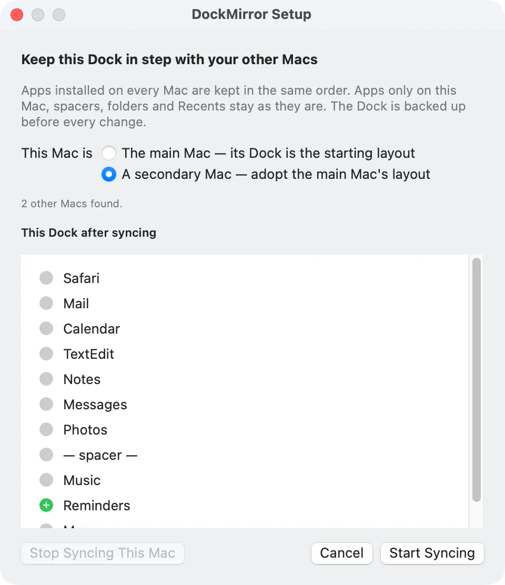
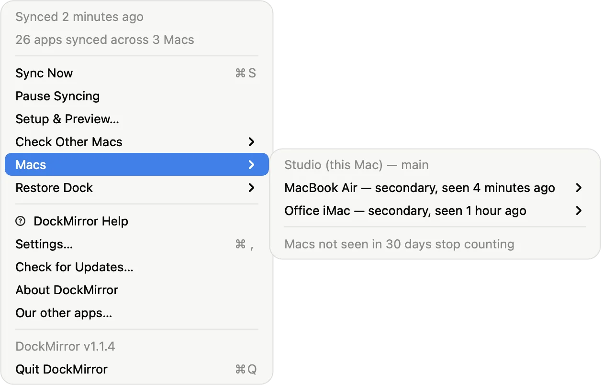
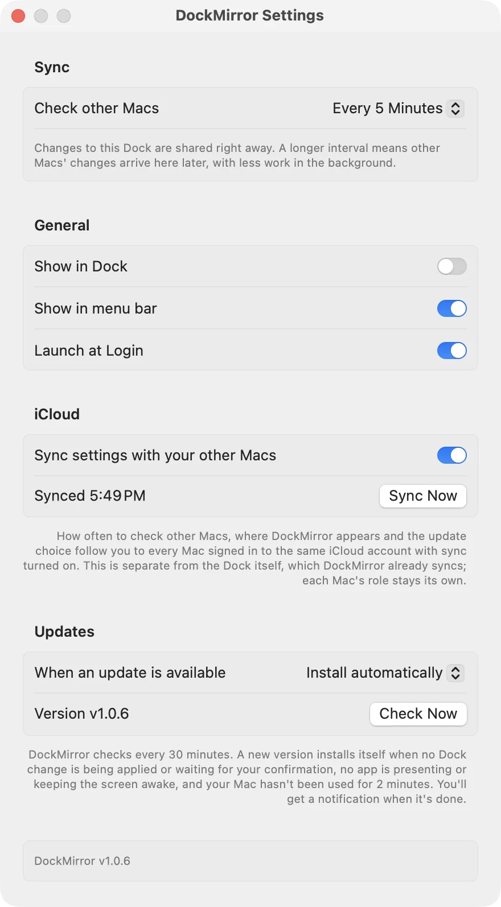

# DockMirror

**Keeps the apps pinned in your Dock in the same order on all of your Macs.**

If you use more than one Mac, their Docks drift apart. You pin an app on one Mac and forget
it on the other, or you reorder things here but not there. Your muscle memory stops working
whenever you switch machines. DockMirror is a menu bar app that syncs the pinned apps in your
Dock through iCloud Drive. Add, remove or move an app on any Mac, and the others follow.

<p align="center"></p>

---

## ⬇️ Download

<p align="center">
  <a href="https://github.com/smanke-org/DockMirror/releases/latest/download/DockMirror.dmg">
    
  </a>
</p>

1. **[Download DockMirror.dmg](https://github.com/smanke-org/DockMirror/releases/latest/download/DockMirror.dmg)**
2. Open it and drag **DockMirror** to **Applications**.
3. Open DockMirror. On your **main Mac** first, choose **Main Mac**. Its Dock becomes the starting layout.
4. Repeat on each other Mac and choose **Secondary Mac**. The setup window previews the result,
   and nothing changes until you click **Start Syncing**.

Every Mac must be signed in to the same Apple Account with iCloud Drive turned on.
Requires macOS 13 or later. Signed with Developer ID and notarized by Apple.

---

## Features

- **One Dock on every Mac**: Add, remove or move a pinned app on any Mac, and your other Macs follow, through iCloud Drive.
- **Main and secondary Macs**: The main Mac's Dock is the starting layout; the others adopt it. Setup previews the result, and nothing changes until you click Start Syncing.
- **Only shared apps**: Only apps installed on every Mac are synced. Apps on just one Mac, spacers, folders, Recents and Dock settings stay as they are.
- **Backed up before every change**: The last 50 Dock backups are kept, and Restore Dock in the menu puts any of them back.
- **Big removals wait for you**: If 5 or more apps, or half of the synced apps, disappear at once, DockMirror asks before spreading the change.
- **Sync within seconds**: Other Macs' changes are picked up as soon as iCloud Drive delivers them, with a check every 30 seconds up to hourly as a backstop, or only when you click Sync Now (⌘S). Pause Syncing stops this Mac until you resume.
- **Macs menu**: See every Mac in the sync and when each last synced, and forget a Mac you no longer use.
- **Settings sync**: How often to check, where DockMirror appears and the update choice can follow you to every Mac on the same iCloud account.
- **URLs** for ToolHUD, Shortcuts or scripts: `dockmirror://sync`, `dockmirror://pause` and `dockmirror://setup`.
- **Dock, menu bar, both or neither**, plus Launch at Login and updates from GitHub that ask first or install automatically.

## Screenshots

<table>
<tr>
<td width="50%" align="center"><br><sub><b>The menu.</b> Sync now, pause, and every Mac in the sync with when it was last seen.</sub></td>
<td width="50%" align="center"><br><sub><b>Settings.</b> How often to check other Macs, where DockMirror appears, settings sync and updates.</sub></td>
</tr>
</table>

## What gets synced

- Only apps installed on **every** Mac are synced. Apps that are only on one Mac stay where
  they are on that Mac.
- Changes sync both ways: add, remove or move an app on any Mac, and the others follow.
- Apps keep their order on every Mac, even several pinned side by side at once. A Mac that
  was asleep when an app was pinned doesn't hold it back from syncing.
- Recents, folders and stacks on the right side, spacers, and Dock settings are never touched.

## Safety

- The whole Dock domain is backed up before every change (the last 50 are
  kept). **Restore Dock** in the menu puts any of them back.
- Large removals are held until you confirm them. That covers 5 or more apps
  at once, or half of the synced apps. Such a change is more likely macOS
  resetting the Dock than a deliberate edit, and spreading it would empty
  every Mac's Dock.
- Uninstalling an app on one Mac stops it being synced. It does not remove it
  from the other Macs' Docks.
- A Mac that hasn't been seen in 30 days stops limiting which apps are synced.
  You can also forget a Mac from the **Macs** menu.
- If the Dock refuses a tile DockMirror adds, that is never mistaken for you
  unpinning the app.

## Settings

Open **Settings…** from the menu bar menu (or ⌘,):

- **Check other Macs:** every 30 seconds (the default), every minute, 5, 15
  or 30 minutes, hourly, or only when you click Sync Now. Edits to this Dock
  are shared right away, and other Macs' edits are picked up within seconds
  of iCloud Drive delivering them. The interval is a backstop for when
  iCloud is slow to report a change.
- **Show in Dock** (off by default) and **Show in menu bar** (on), in any
  combination. Right-clicking the Dock icon offers **Settings…**. With
  both off, DockMirror keeps syncing with no icon; open it again from
  Applications or Spotlight to get back to Settings.
- **Launch at Login.**
- **Sync settings with your other Macs:** how often to check other Macs, where
  DockMirror appears and the update choice follow you to every Mac on the same
  iCloud account, through `iCloud Drive/DockMirror/Settings.plist`. This is
  separate from the Dock itself, which DockMirror already syncs; each Mac's
  role stays its own. A brand-new install that finds this file turns sync on and
  starts from your settings.

For ToolHUD, Shortcuts or scripts, `dockmirror://sync` syncs now, `dockmirror://pause` pauses or
resumes syncing, and `dockmirror://setup` opens Setup & Preview.

### Command line and AI agents

DockMirror is also a command line tool, so scripts and AI agents (Claude Code, Codex) can check the sync, list this
Dock, the other Macs and the Dock backups, sync now, pause and resume, set up or stop syncing, and answer a held big
removal. Commands run in the open app, through the same code as the menu bar menu. Link it once to type `dockmirror`:

```bash
ln -s /Applications/DockMirror.app/Contents/MacOS/DockMirror ~/.local/bin/dockmirror
```

```bash
dockmirror help
dockmirror status --json
dockmirror dock list
dockmirror sync now
```

Every command takes `--json`. Starting setup, applying a big removal, restoring a backup and forgetting a Mac only
show what they would do until you add `--yes`. For MCP apps such as Claude Desktop, the same commands are served by
`/Applications/DockMirror.app/Contents/MacOS/DockMirror mcp`:

```bash
claude mcp add --scope user dockmirror -- /Applications/DockMirror.app/Contents/MacOS/DockMirror mcp
```

## Updates

DockMirror checks GitHub for a new release once a day, or as often as you choose in Settings (a number of hours, days, weeks or months).
**When an update is available** in Settings decides what happens:

- **Ask me first** (the default): a notification and an *Update to …* menu item; nothing
  installs until you click it.
- **Install automatically**: the update is downloaded and checked right away, then installed
  once no Dock change is being applied or waiting for your confirmation, no app is presenting
  or keeping the display awake, and the Mac hasn't been used for 2 minutes.
- **Don't check**: *Check for Updates…* in the menu still works.

 Before installing, the download must be signed by the same
developer and notarized by Apple. It is installed in place, so your settings carry over.

## How it works

- **Storage.** The Dock keeps its layout in the `com.apple.dock` preferences.
  DockMirror reads and writes only `persistent-apps`, through CFPreferences,
  then restarts the Dock. Apps are matched across Macs by bundle identifier.
- **Sharing.** Each Mac writes one file, `iCloud Drive/DockMirror/Devices/<id>.json`.
  It reads everyone else's. With a single writer per file, iCloud never has
  conflicting copies to resolve.
- **Merging.** Every app has its own entry: pinned or not, plus a position key.
  The most recent change to an app wins. Position keys are fractional, so
  moving one app changes only that app's entry. Edits to different apps on
  different Macs therefore never collide.
- **Detecting changes.** The Dock rewrites its preferences file for many
  reasons, Recents included. After three quiet seconds, so a drag in progress
  is never synced half-way, DockMirror compares just the pinned apps and does
  a full sync only if they changed. Other Macs' files are watched, so their
  changes sync about two seconds after they arrive, and are also checked at
  the chosen interval and on wake. A file that hasn't changed is never re-read,
  and app-location lookups are cached for 10 minutes.

## Building

```bash
swift test         # sync engine tests
./build_app.sh     # .build/app/DockMirror.app
```

`DOCKMIRROR_SYNC_FOLDER=/some/folder` points the app at a scratch folder
instead of iCloud Drive. A debug build shares this Mac's device ID, so always
set this when testing. `DOCKMIRROR_DRY_RUN=1` plans and publishes but never
writes the Dock. `defaults read com.smanke.DockMirror diagnostics` shows the
role, the synced order, and the last error or hold.

To try the `dockmirror` command line on test data, run a debug build with `APP_STORE=/tmp/dockmirror-test` in front.
That starts a test copy with its own sync folder, backups and settings, which never writes the Dock and starts no
watching, timers, menu bar item or updater. Release builds ignore `APP_STORE`.

## Releasing

```bash
./release.sh "Developer ID Application: …"   # sign, notarize, staple
./make_dmg.sh                                # notarized .dmg, plus DockMirror.dmg
gh release create vX.Y.Z .build/app/DockMirror-X.Y.Z.dmg .build/app/DockMirror.dmg \
  --repo smanke-org/DockMirror
```

Upload both images. The README's download button points at
`releases/latest/download/DockMirror.dmg`, which only works if every release
carries a file with exactly that name.

## License

© 2026 Steve Manke. All rights reserved.
